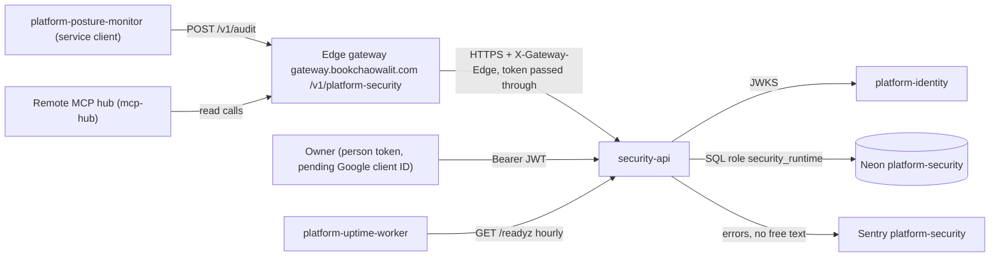
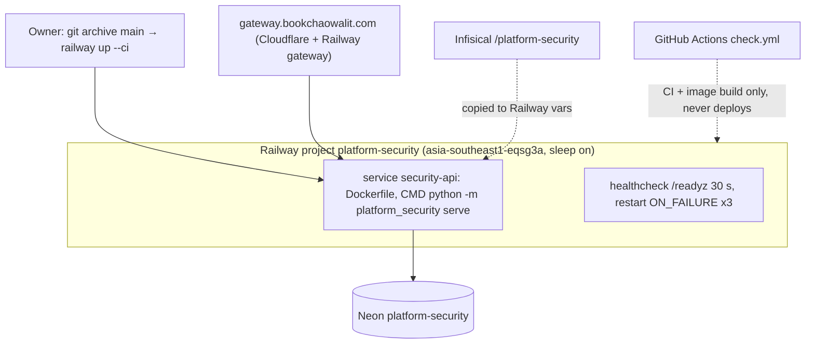

# Book Security Platform — System Architecture

เอกสารนี้สรุปสถาปัตยกรรมของ `security-api` จากโค้ดและ config ใน repo (ณ `origin/main` `29dbb06`, 2026-11-04) รายละเอียดอยู่ใน Core 22 diagram pack [`docs/diagrams/`](../docs/diagrams/README.md) และ [`docs/runtime.md`](../docs/runtime.md); เอกสารนี้ลิงก์ ไม่คัดลอก
ข้อเท็จจริง hosting ที่ไม่อยู่ใน repo อ้าง `ops record: book-platforms-status (2026-11-03)` และ `ops record: api-gateway-edge (2026-11-03)`

หมายเหตุ tier: `docpack.yaml` ยังเป็น `tier: L0` และ `contract.json` ยังเป็น status `scaffolded` (ถูกบังคับโดย `tests/test_check.py::test_status_must_stay_scaffolded`) แม้ service live ตั้งแต่ 2026-11-02; เอกสารนี้ไม่เปลี่ยน tier

## 1. Architecture style และเหตุผล

- **Microservice ขนาดเล็กบน shared core**: service เดียว (FastAPI) ที่สร้างจาก `platform-backend-core` (`create_app`, `require_scope`, `TokenVerifier`, `Database`, `MigrationRunner`) เหมือน platform services อีก 7 ตัว ([ADR-0001](../docs/diagrams/08-adr/ADR-0001-fastapi-on-shared-backend-core.md)) เพื่อให้ auth, body limit, diagnostics และ RLS เหมือนกันทุก service
- **Database-per-service + forced RLS ต่อ workspace**: Neon project ของตัวเอง, workspace มาจาก claim `ws` ของ token เท่านั้น ([ADR-0002](../docs/diagrams/08-adr/ADR-0002-postgres-forced-rls-separate-roles.md))
- **Reference-only secrets**: service เก็บเฉพาะ metadata ของ secret reference (provider + ref) ไม่เก็บค่า secret; schema และ detector ปฏิเสธค่าที่ดูเป็น secret (`contracts/security/`, `tests/test_security_contracts.py`)
- **Append-only audit**: audit เป็น log ที่แก้/ลบไม่ได้ระดับ DB trigger ([ADR-0004](../docs/diagrams/08-adr/ADR-0004-append-only-idempotent-audit.md))
- **Serverless**: Railway sleep on + Neon free project แยก ([ADR-0006](../docs/diagrams/08-adr/ADR-0006-railway-serverless-neon-dedicated.md)) เพราะ traffic ต่ำ (ผู้เรียกหลักคือ posture-monitor ทุก 6 ชม. ตาม ops record)

## 2. Quality-attribute scenarios

| ID | Attribute | Scenario (stimulus → response) | กลไก | หลักฐาน |
|---|---|---|---|---|
| QA-01 | Confidentiality | caller ส่งค่า secret จริงใน `PUT /v1/secret-references/{name}` → 422 ไม่บันทึก | detector + schema reference-only | `store.py`, `runtime_tests/test_http.py::test_secret_value_rejected_audit_identity_bound_and_permissions` |
| QA-02 | Integrity | มีคนพยายาม UPDATE/DELETE/TRUNCATE `security_audit` → DB ปฏิเสธ | trigger `immutable_audit`, REVOKE | `migrations.py`, `runtime_tests/test_runtime.py::test_audit_append_idempotent_and_immutable` |
| QA-03 | Reliability | posture-monitor ส่ง audit event ซ้ำ (retry) พร้อมกัน → ได้ event เดียว; ถ้า body ต่าง → 409 | `Idempotency-Key` + fingerprint + `ON CONFLICT DO NOTHING` | `test_audit_concurrent_dedupe_is_atomic` |
| QA-04 | Isolation | token workspace A อ่าน/เขียนข้อมูล workspace B → ไม่เห็น/ถูกปฏิเสธ | forced RLS บน `app.workspace_id` | `test_reference_and_audit_force_rls_reject_foreign_inserts` |
| QA-05 | Safe operation | runtime role ได้ grant เกินหรือ trigger ถูกปิด → `/readyz` 503, Railway ไม่ปล่อย deploy | readiness checks ของ privilege | `test_readiness_requires_each_effective_privilege`, `test_readiness_rejects_each_forbidden_audit_privilege` |
| QA-06 | Privacy (observability) | exception ที่มีข้อมูลส่วนตัวใน message → Sentry ได้แค่ type/stack/route | `_scrub_event` ทิ้ง free text | `runtime_tests/test_sentry.py::test_no_exception_text_leaves_the_process` |
| QA-07 | Latency (cold start) | request แรกหลัง sleep → รอ container start + Neon resume | core pool wait 20 s, connect timeout 15 s | 16-deployment, ops record |

ยังไม่มีเป้าหมายตัวเลขของ latency/availability ใน repo

## 3. Context diagram

ภาพเต็ม: [05-c4-context.md](../docs/diagrams/05-c4-context.md)

Gateway route `platform-security` → `https://security-api-production-f817.up.railway.app` อยู่ใน platform-api-gateway `routes.json` @ `4a31ff5`; gateway ตรวจ RS256 แล้วส่ง token ต่อ ส่วน audience/scope ยังตรวจที่ security-api (ops record: api-gateway-edge) direct URL ยังเรียกได้ (ยังไม่มี gateway-signed assertion)

## 4. Components / containers

ภาพ: [06-c4-container.md](../docs/diagrams/06-c4-container.md), [07-c4-component.md](../docs/diagrams/07-c4-component.md)

| Container / component | เทคโนโลยี | หน้าที่ | หลักฐาน |
|---|---|---|---|
| `security-api` (`serve`) | Python 3.12, FastAPI, uvicorn (limit_concurrency 100) | HTTP API port 8080 | `__main__.py`, `Dockerfile` |
| `migrate` (one-off) | image เดียวกัน | DDL ด้วย owner role, ไม่รันตอน startup | `__main__.py`, `migrations.py` |
| `app.py` routes | FastAPI + Pydantic (`extra=forbid`) | `PUT/GET /v1/secret-references`, `POST/GET /v1/audit` | `app.py` |
| `store.py` `SecurityStore` | psycopg | validation, SQL, idempotency fingerprint, `ready()` | `store.py` |
| `EnvironmentResolver` | in-process | resolve reference → env (ใช้ใน test เท่านั้น ไม่มี route) | `store.py`, 07 |
| `_sentry.py` + `CaptureErrors` | sentry-sdk | innermost middleware จับ 500 ที่ core `_Boundary` กลืน | `_sentry.py`, `app.py` |
| core `_Boundary`, `require_scope`, `TokenVerifier`, `Database`, diagnostics | platform-backend-core @ `21d5f44` | body limit 8192, timeout 30 s, `x-request-id`, redacted 500, `/healthz` `/readyz` `/metrics`, pool max 8 | ADR-0001, 07 |

## 5. Tech stack

| ชั้น | เทคโนโลยี | หลักฐาน |
|---|---|---|
| Runtime | Python ≥ 3.12, image `python:3.12-slim` two-stage, UID 65532 | `pyproject.toml`, `Dockerfile` |
| Framework / shared core | `platform-backend-core==0.1.0` pin Git commit `21d5f44d26220080cbed43b9807979dc84a8533a` ผ่าน `[tool.uv.sources]` + `uv.lock` (`uv sync --frozen`) กัน dependency confusion | `pyproject.toml`, `uv.lock`, `Dockerfile` |
| Server / client | uvicorn, httpx | `pyproject.toml` |
| Observability | sentry-sdk ≥ 2.72 | `_sentry.py` |
| Tooling | ruff 0.17.1, mypy 2.4.0 (src + scripts + tests), pytest-cov 7.1.0 | `pyproject.toml` |
| CI | platform-ci-workflows `ci-python.yml` / `security.yml` @ `87dc5e1c` (v1.1.1) | `.github/workflows/check.yml` |

**ความผูกพันกับ `platform-backend-core`**: security ใช้ core เป็น runtime dependency หลัก (HTTP boundary, auth, DB, migrations) การเปลี่ยน behaviour ของ core (เช่น pool check ก่อนใช้ เพราะ Neon suspend 5 นาที) มาถึง service นี้เมื่อ repin เท่านั้น; ปัจจุบันยัง pin `21d5f44` ขณะที่ core main มี `ServiceTokenSource` (`dc1fa7d`) แล้ว (ops record) ซึ่ง security ไม่ต้องใช้เพราะไม่เรียก service อื่น

## 6. Data stores

| Store | ข้อมูล | กลไกป้องกัน | หลักฐาน |
|---|---|---|---|
| Neon `platform-security` (PG 16, aws-ap-southeast-1) ตาราง `secret_references` | ชื่อ, provider, ref (ไม่มีค่า secret) ต่อ workspace | forced RLS | `migrations.py`, [09-erd.md](../docs/diagrams/09-erd.md) |
| ตาราง `security_audit` | actor, action, target, event_key, fingerprint | forced RLS, trigger `immutable_audit`, `UNIQUE(workspace_id, event_key)` | `migrations.py`, ADR-0004 |
| `platform_schema_migrations` | checksum ของ migration ที่ apply | readiness ต้องการ checksum ตรง | core `MigrationRunner`, `test_applied_migration_checksum_required` |

Roles: owner (DDL) และ `security_runtime` (NOSUPERUSER NOBYPASSRLS, grant เท่าที่ readiness ต้องการ) ไม่มี cache หรือ object storage

## 7. Integrations

| ระบบ | ทิศทาง | ใช้ทำอะไร | สถานะ | หลักฐาน |
|---|---|---|---|---|
| platform-identity | security → identity | JWKS (`JWT_JWKS_URL`), issuer `https://identity-api-production-fad1.up.railway.app`, audience `security-api`; identity map `references:*`, `audit:*` → `security.*` | live 2026-11-02/03 | [ADR-0003](../docs/diagrams/08-adr/ADR-0003-rs256-jwt-from-platform-identity.md), ops record |
| Edge gateway | gateway → security | route `platform-security` สำหรับ posture-monitor และ MCP hub | live 2026-11-03 | platform-api-gateway `routes.json` @ `4a31ff5`, ops record: api-gateway-edge |
| platform-posture-monitor | client → security | `POST /v1/audit` ด้วย service client token | live 2026-11-03 | ops record |
| Remote MCP hub | client → security | cell `platform-security` อ่านข้อมูล | live 2026-11-03 | ops record |
| Neon | security → DB | `DATABASE_URL` | live | ADR-0006 |
| Sentry | security → Sentry | errors only, no free text | live | [ADR-0005](../docs/diagrams/08-adr/ADR-0005-sentry-no-free-text.md) |
| Uptime worker | worker → security | `GET /readyz` รายชั่วโมง | live | 05, ops record |
| R2 / Queues / Kafka | — | ไม่ใช้ | not applicable: ไม่มีโค้ดเรียก | `src/` |

## 8. Deployment topology

ภาพเต็ม: [16-deployment.md](../docs/diagrams/16-deployment.md)

- ตัวแปร (ชื่อเท่านั้น): `DATABASE_URL`, `JWT_ISSUER`, `JWT_AUDIENCE`, `JWT_JWKS_URL` หรือ `JWT_PUBLIC_KEY` (อย่างใดอย่างหนึ่ง), `PORT`, `SENTRY_DSN`, `SENTRY_ENVIRONMENT`, `SENTRY_RELEASE`, `RAILWAY_GIT_COMMIT_SHA`, `RAILWAY_SERVICE_NAME`
- มี environment เดียว (production)

## 9. ADR สำคัญ

| ID | การตัดสินใจ | ไฟล์ |
|---|---|---|
| ADR-0001 | FastAPI บน platform-backend-core pin Git commit ใน `uv.lock` | [ADR-0001](../docs/diagrams/08-adr/ADR-0001-fastapi-on-shared-backend-core.md) |
| ADR-0002 | PostgreSQL forced RLS, workspace จาก token, แยก DDL/runtime role | [ADR-0002](../docs/diagrams/08-adr/ADR-0002-postgres-forced-rls-separate-roles.md) |
| ADR-0003 | RS256 workspace JWT จาก platform-identity, route ละหนึ่ง scope | [ADR-0003](../docs/diagrams/08-adr/ADR-0003-rs256-jwt-from-platform-identity.md) |
| ADR-0004 | Audit append-only ด้วย DB trigger + idempotency fingerprint | [ADR-0004](../docs/diagrams/08-adr/ADR-0004-append-only-idempotent-audit.md) |
| ADR-0005 | Sentry errors only, ไม่มี free text ออกจาก process | [ADR-0005](../docs/diagrams/08-adr/ADR-0005-sentry-no-free-text.md) |
| ADR-0006 | Railway serverless + Neon project แยก, deploy ด้วย CLI | [ADR-0006](../docs/diagrams/08-adr/ADR-0006-railway-serverless-neon-dedicated.md) |

## 10. Fitness functions

| Guard | ตรวจอะไร | ที่อยู่ |
|---|---|---|
| Contract check (3.11 + 3.12, stdlib) | `contract.json`, security contracts, policy matrix deny-by-default, fixtures | `scripts/check.sh`, `tests/test_check.py`, `tests/test_security_contracts.py`, `tests/test_contract_files.py` |
| Build hygiene | ทุก action SHA-pinned, lock ชี้ core commit ที่ review แล้ว, Dockerfile multi-stage + non-root, deps มาจาก lock เท่านั้น, CI build image แต่ไม่ push | `tests/test_build_hygiene.py` |
| Runtime tests (Postgres จริง) | RLS, append-only, idempotency, readiness privileges, migration checksum, pool reuse, error mapping (422 เฉพาะ domain input) | `runtime_tests/*.py`, job `python` |
| Sentry no-free-text (real client) | ไม่มี exception text ออกจาก process | `runtime_tests/test_sentry.py` |
| Coverage gate | ≥ 87% (ratchet จาก 87.06% วันที่ 2026-10-24) | `check.yml` `coverage-threshold: "87"` |
| Lint / type | ruff, mypy (src, scripts, tests, runtime_tests) | `pyproject.toml` |
| Image smoke | import `platform_backend_core` + app และ uid ≠ 0 | job `image` ใน `check.yml` |
| Security baseline | shared `security.yml` | job `security` |
| Deploy gate | Railway healthcheck `/readyz` (schema/grant/RLS/trigger) | `.railway/railway.ts` |

## 11. เอกสารลงรายละเอียด phase 07

| Template | สถานะ | ไฟล์ / เหตุผล |
|---|---|---|
| `sdlc/infrastructure-and-network-design.md` | partial (ภาพ) | [16-deployment.md](../docs/diagrams/16-deployment.md), [19-service-dependency-map.md](../docs/diagrams/19-service-dependency-map.md) |
| `sdlc/observability-design.md` | partial | [20-observability.md](../docs/diagrams/20-observability.md); ไม่มี SLO |
| `sdlc/capacity-performance-and-cost-plan.md` | missing | ไม่มี workload model/load test |
| `sdlc/failure-mode-analysis.md` | partial | [13-threat-model.md](../docs/diagrams/13-threat-model.md), [14-backup-dr.md](../docs/diagrams/14-backup-dr.md), [21-incident-response.md](../docs/diagrams/21-incident-response.md) |
| `sdlc/async-integration-contract.md` | not_applicable | ไม่มี queue/event/webhook/job; audit รับแบบ synchronous HTTP พร้อม idempotency key |
| `sdlc/frontend-architecture.md` | not_applicable | API อย่างเดียว ไม่มี UI |
| `sdlc/tech-debt-register.md` | missing | debt อยู่ใน Open questions ของ diagrams |
| `operations/system-landscape.md` | external | central [C4-DIAGRAMS.md](https://github.com/bookchaowalit/architecture-docs/blob/main/docs/architecture/C4-DIAGRAMS.md) ยังไม่มี security-api (05) |
| `development-cycle/vendor-dependency-review.md` | missing | Railway, Neon, Sentry |

## Open questions

- deployed commit ปัจจุบัน (first deploy 2026-11-02; ไม่มีบันทึก deploy ของ `0187719` ใน repo)
- `migrate` รันจากเครื่อง owner หรือ Railway one-off
- จะให้ security-api ปฏิเสธ direct call (ต้องรอ gateway-signed assertion) หรือไม่
- `contract.json` status `scaffolded` และ product card "ยังไม่มี runtime" ควรอัปเดตเมื่อไร (ต้องแก้ test ที่บังคับ status ด้วย)
- backup/restore drill ของ Neon `platform-security` และ RTO/RPO (14)
- core pin `21d5f44`: จะ repin เมื่อไร
- `CaptureErrors` ของ security ไม่มี guard "no active client" ที่อีก 7 services มี (ops record): ต้อง port กลับหรือไม่

## การอนุมัติ

| บทบาท | สถานะ | วันที่ | ลงนาม |
|---|---|---|---|
| Solution Architect (Book Dev) | รอตรวจ | — | [ต้องยืนยัน] |
| Owner | รอตรวจ | — | [ต้องยืนยัน] |

## แหล่งข้อมูล

อ่านที่ `origin/main` `29dbb06037ffd3aa2a21cc5d37bc5948e7f1245a` (2026-11-04):

- `pyproject.toml`, `Dockerfile`, `.railway/railway.ts`, `.github/workflows/check.yml`, `contract.json`, `DOCPACK/docpack.yaml`
- `src/platform_security/__main__.py`, `app.py`, `store.py`, `migrations.py`, `_sentry.py`
- `tests/test_build_hygiene.py`, `test_check.py`, `test_contract_files.py`, `test_security_contracts.py`, `runtime_tests/test_http.py`, `test_runtime.py`, `test_sentry.py`, `test_error_mapping.py`, `test_pool_reuse.py`
- `docs/runtime.md`, `docs/gates/BOO-163-security-policy-contracts.md`, `docs/diagrams/` (README, 05, 06, 07, 16, 08-adr/*)
- platform-api-gateway `routes.json` @ `4a31ff5` (route `platform-security`)
- ops record: book-platforms-status (2026-11-03), ops record: api-gateway-edge (2026-11-03)
