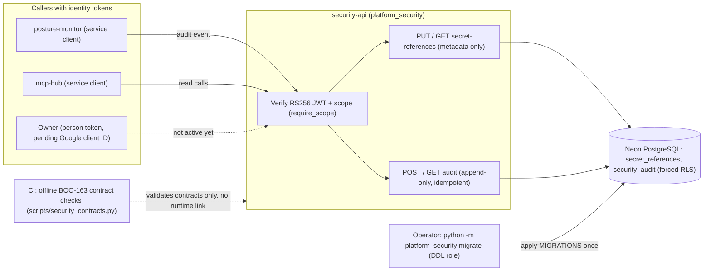
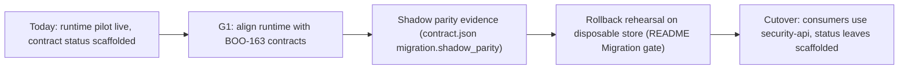

# 01 — Business process (As-Is / To-Be)

`platform-security` เป็น backend platform service ของ Book Platform ที่ถือ capability `security` (secret references, policy, audit, WAF controls, privacy ตาม `contract.json`) ส่วนที่มี runtime จริงคือ API สำหรับเก็บ **metadata ของ secret reference** (ไม่ใช่ค่า secret) และ **audit log แบบ append-only** ต่อ workspace

## As-Is (จาก code วันนี้)

กระบวนการจริงมีสองเส้น: (1) ผู้เรียกที่ถือ token ของ platform-identity บันทึก/อ่าน secret reference และ audit event; (2) ฝั่ง operator รัน `migrate` แยกจาก `serve` แล้วให้ runtime role ที่ไม่ใช่ owner ใช้งาน ส่วน contract BOO-163 (tenant, permission, privacy) ถูกตรวจแบบ offline ใน CI เท่านั้น ยังไม่มี runtime บังคับใช้

Sources: `contract.json`, `src/platform_security/app.py`, `src/platform_security/store.py`, `src/platform_security/__main__.py`, `src/platform_security/migrations.py`, `scripts/security_contracts.py`, `docs/runtime.md`, `docs/gates/BOO-163-security-policy-contracts.md`, ops record: book-platforms-status (2026-11-03)

## To-Be (จาก PRODUCT.md และ gate doc เท่านั้น)

ไม่มี `docs/UPGRADE-PLAN.md` หรือ `specs/` ใน repo นี้ To-Be ที่เขียนไว้จริงมีแค่:

- PRODUCT.md: capability ต้องย้ายออกจาก `solo-empire` control plane ได้ "without consumers noticing" หลังมี parity และ rollback evidence; `contract.json` ยังเป็น `scaffolded` และ `migration.cutover: pending`
- BOO-163 gaps G1–G7: runtime ต้อง conform กับ contract (provider `infisical`, `#version`, `outcome`/`privacy_class`/`prev_hash`) ก่อนย้าย consumer; `waf-controls` ยังไม่มี contract

Sources: `PRODUCT.md`, `README.md` (Migration gate), `contract.json`, `docs/gates/BOO-163-security-policy-contracts.md`

## Open questions

- เกณฑ์ cutover ยังเป็น `[ต้องยืนยัน]` ใน PRODUCT.md (Measures)
- PRODUCT.md / README ยังบอกว่า "not pushed or deployed" ขัดกับ `docs/runtime.md` (deployed 2026-11-02) ต้องให้ owner อัปเดต status
- "current implementation" `solo-empire:infra/platform` ไม่มีแล้ว (gap G2) — ตอนนี้ไม่มี As-Is ฝั่ง legacy ให้วาด
