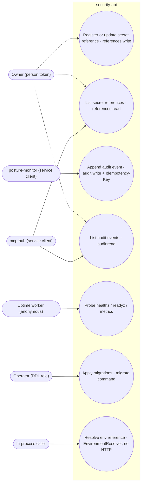

# 02 — Use cases

Actor คือ identity ที่ service ตรวจจริง: JWT RS256 จาก issuer ที่ตั้งใน `JWT_ISSUER`, audience `JWT_AUDIENCE` (production = `security-api`), และ scope ใน claim `scope` ที่ `require_scope()` ตรวจต่อ route ส่วน workspace มาจาก claim `ws` และ actor มาจาก `sub` เสมอ

| Actor | ประเภท token / สิทธิ์ | ที่มา |
|---|---|---|
| Owner | person token (ยังรอ `IDENTITY_GOOGLE_CLIENT_IDS`) | ops record |
| posture-monitor | identity service client, ใช้ `audit:write` → `POST /v1/audit` 200 | ops record |
| mcp-hub | identity service client, 31 owner scopes, **ไม่มี** `audit:write` | ops record |
| Uptime worker | ไม่มี token, เรียก `/readyz` | platform-uptime-worker `src/targets.ts` |
| Operator (DDL role) | ไม่ผ่าน HTTP, ใช้ `DATABASE_URL` ของ owner role | `__main__.py`, `docs/runtime.md` |
| In-process code | `EnvironmentResolver` (ไม่มี route) | `store.py` |

เส้นประ = ยังไม่ active (person token รอ Google client ID) สิทธิ์ scope ที่ mcp-hub ถือจริงสำหรับ `references:*` ไม่ได้ระบุใน ops record (ระบุแค่ว่าไม่มี `audit:write`)

Sources: `src/platform_security/app.py`, `src/platform_security/__main__.py`, `src/platform_security/store.py`, platform-backend-core@21d5f44 `src/platform_backend_core/http.py` (`require_scope`), `src/platform_backend_core/auth.py` (`TokenVerifier.verify`), `docs/runtime.md`, ops record: book-platforms-status (2026-11-03), platform-uptime-worker `src/targets.ts`

## Role matrix ใน contract (ยังไม่ผูกกับ runtime)

`contracts/security/permission-matrix.json` นิยาม role `owner/admin/operator/auditor/viewer/service` แบบ deny-by-default และ map legacy scopes (`references:read` → `secret_reference:read`, `audit:write` → `audit:append`) แต่ runtime ตรวจแค่ scope string ใน token ไม่ได้อ่าน matrix นี้ (gap G1)

## Open questions

- mcp-hub ได้ `references:read` / `references:write` หรือไม่ (ops record บอกแค่ 31 owner scopes)
- ใครควรถือ `references:write` ใน production (ยังไม่มี consumer ที่เขียน reference จริง)
