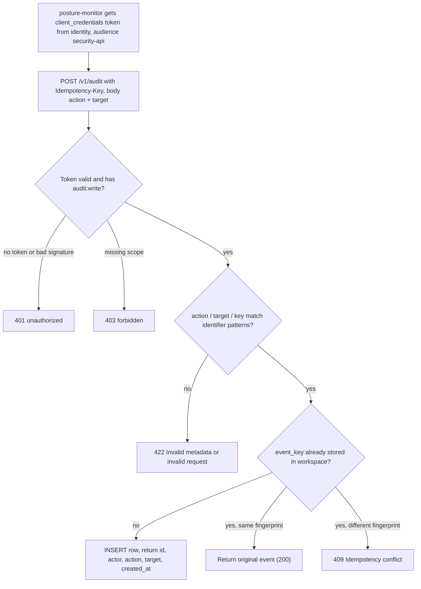
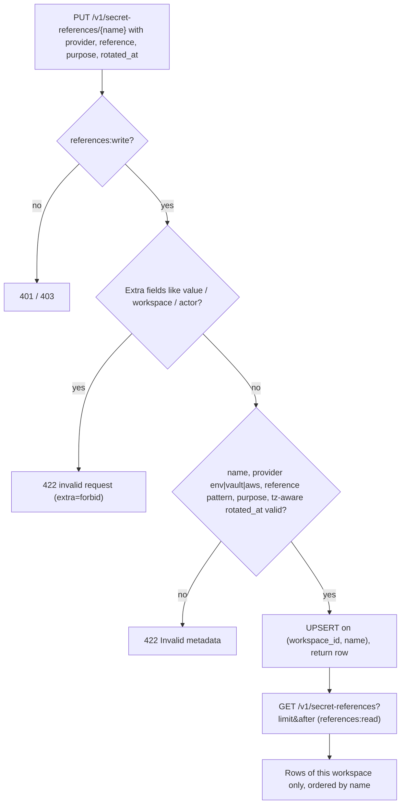
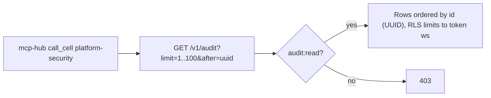
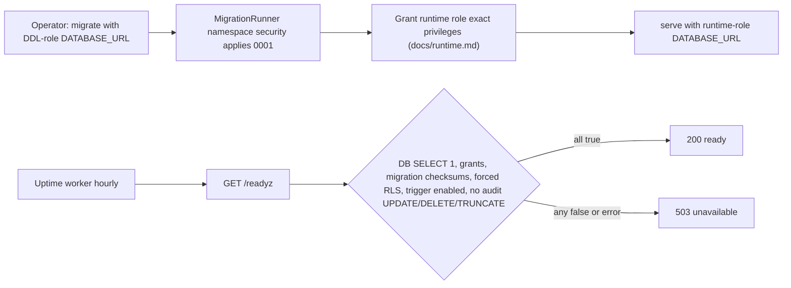

# 03 — User flows (API call flows per caller)

service นี้ไม่มี UI flow คือลำดับ API call ของแต่ละ caller ทุก flow ผ่าน `_Boundary` ของ core (body ≤ 8192 bytes, timeout 30 s) → `require_scope` → handler → `Database.transaction(workspace)` ที่ตั้ง `app.workspace_id`

## Flow A — posture-monitor บันทึก audit event (active)

## Flow B — ผู้ถือ references scope บันทึกและอ่าน secret reference

## Flow C — mcp-hub อ่าน audit (read-only)

## Flow D — operator / uptime probe

Sources: `src/platform_security/app.py`, `src/platform_security/store.py`, `src/platform_security/__main__.py`, platform-backend-core@21d5f44 `http.py`, `auth.py`, `db.py`, `docs/runtime.md`, `runtime_tests/test_http.py`, ops record: book-platforms-status (2026-11-03), platform-uptime-worker `src/targets.ts`

## Open questions

- ยังไม่มี caller ใดใน ops record ที่เรียก `PUT /v1/secret-references` จริง — Flow B เป็นความสามารถที่มี แต่ไม่รู้ว่ามีผู้ใช้
- mcp-hub เรียก route ไหนบ้างใน `call_cell` (ops record บอกแค่ว่า security 200)
