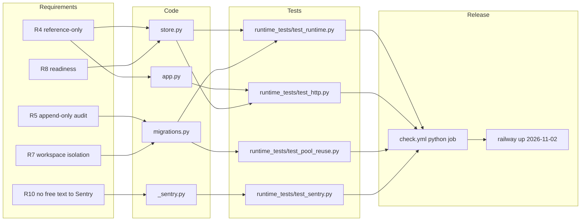

# 04 — Requirements traceability matrix (RTM)

ไม่มี `specs/` ใน repo requirement มาจาก `PRODUCT.md`, `README.md`, gate doc BOO-163 และ `docs/runtime.md` (ซึ่งบันทึก red/green ของแต่ละ change) Release column = workflow/การ deploy ที่พา requirement ไป production

| ID | Requirement (source) | Code module | Test file(s) | Release / workflow |
|---|---|---|---|---|
| R1 | `contract.json` valid, status stays `scaffolded` (PRODUCT.md Capabilities) | `scripts/check.py` | `tests/test_check.py` | `check.yml` job `contract` (3.11 / 3.12) |
| R2 | Tenant contract (BOO-163) | `scripts/security_contracts.py` `tenant_errors` | `tests/test_security_contracts.py` `TenantTests` | `check.yml` `contract`; no runtime |
| R3 | Permission matrix deny-by-default; only `service` resolves secrets / appends audit (BOO-163 rule 2) | `security_contracts.py` `permission_policy_errors`, `authorize`; `contracts/security/permission-matrix.json` | `PermissionTests`, `tests/test_contract_files.py` | `check.yml` `contract`; runtime not wired (G1) |
| R4 | Secret reference is reference-only, never a value (BOO-163 rule 1, runtime.md) | offline: `secret_reference_errors`, `is_secret_like`; runtime: `store.reference`, `store.identifier`, `app.Reference` (`extra=forbid`) | `SecretReferenceTests`; `runtime_tests/test_runtime.py::test_reference_only_and_unknown_resolution`; `runtime_tests/test_http.py::test_secret_value_rejected_audit_identity_bound_and_permissions` | `check.yml` `contract` + `python`; Railway deploy 2026-11-02 |
| R5 | Audit append-only + idempotent (BOO-163 rule 3, runtime.md) | `migrations.py` trigger `immutable_audit`, `UNIQUE(workspace_id,event_key)`; `store.append` fingerprint; offline `AuditLog` | `AuditTests`; `test_runtime.py::test_audit_append_idempotent_and_immutable`, `::test_audit_concurrent_dedupe_is_atomic` | `python` job (PostgreSQL); deploy 2026-11-02 |
| R6 | Privacy classes ordered, metadata redaction (BOO-163 rule 4) | `security_contracts.py` `privacy_policy_errors`, `redact_audit_metadata` | `PrivacyTests`, `AuditTests::test_privacy_redaction_is_applied_on_append` | `contract` job; no runtime |
| R7 | Workspace isolation: authority only from JWT `ws` / `sub` (runtime.md) | `migrations.py` forced RLS; core `Database.transaction`; `app.py` uses `p.workspace`, `p.actor` | `test_runtime.py::test_reference_and_audit_force_rls_reject_foreign_inserts`; `runtime_tests/test_pool_reuse.py` | `python` job; deploy 2026-11-02 |
| R8 | Readiness checks exact migrations, grants, RLS, trigger (runtime.md) | `store.SecurityStore.ready`; core `/readyz` | `test_http.py::test_missing_schema_is_not_ready`, `::test_applied_migration_checksum_required`, `::test_readiness_requires_each_effective_privilege`, `::test_readiness_rejects_each_forbidden_audit_privilege` | `python` job; Railway healthcheck `/readyz` |
| R9 | 422 only for domain input, other errors redacted 500 (runtime.md 2026-10-29) | `store.InvalidInput`, `app.py` exception handlers | `runtime_tests/test_error_mapping.py` | `python` job |
| R10 | No free text to Sentry (runtime.md 2026-11-03) | `src/platform_security/_sentry.py` | `runtime_tests/test_sentry.py` | PR #14 merged 0187719; deploy of that commit not recorded |
| R11 | Image builds from clean checkout, non-root, lock-only deps (runtime.md build hygiene) | `Dockerfile`, `.dockerignore`, `pyproject.toml` `[tool.uv.sources]` | `tests/test_build_hygiene.py` | `check.yml` job `image` |
| R12 | Coverage ≥ 87 % (ADR-0004 ratchet) | `pyproject.toml` `[tool.coverage.run]` | whole pytest suite | `check.yml` job `python` `coverage-threshold: "87"` |
| R13 | `waf-controls` capability (`contract.json`) | none | none | **gap G5** |

Sources: `PRODUCT.md`, `README.md`, `contract.json`, `docs/runtime.md`, `docs/gates/BOO-163-security-policy-contracts.md`, `fixtures/gates/security-policy-contracts.json`, `scripts/check.py`, `scripts/security_contracts.py`, `src/platform_security/*.py`, `tests/*.py`, `runtime_tests/*.py`, `.github/workflows/check.yml`, `pyproject.toml`

Gate evidence เดิม: [`docs/gates/BOO-163-security-policy-contracts.md`](../gates/BOO-163-security-policy-contracts.md) (reused สำหรับ R2–R6)

## Open questions

- G1: runtime (`env/vault/aws`, scopes `references:*`/`audit:*`, audit ไม่มี `outcome`/`privacy_class`/`prev_hash`) ยังไม่ตรง contract ที่ owner accept 2026-10-16 — ต้องตัดสินว่าจะ align runtime หรือแก้ contract
- R10: commit 0187719 ถูก deploy ไป Railway แล้วหรือยัง ไม่มีหลักฐานใน repo
