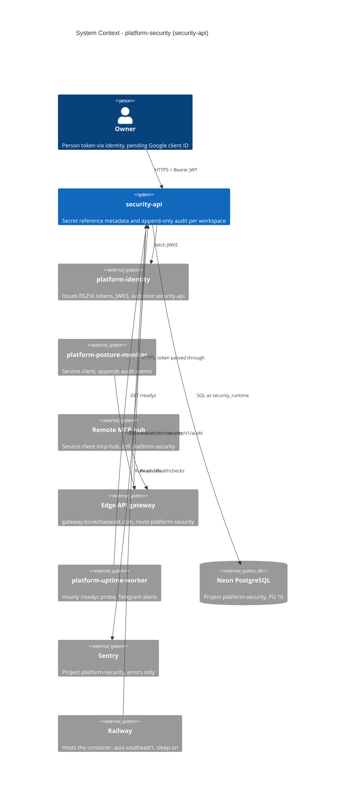

# 05 — C4 Context

Sources: `src/platform_security/__main__.py` (JWT_JWKS_URL, DATABASE_URL), `src/platform_security/_sentry.py`, `railway.toml`, `docs/runtime.md` (Sentry and first deployment), ops record: book-platforms-status (2026-11-03), ops record: api-gateway-edge (2026-11-03), platform-api-gateway `routes.json` @ `4a31ff5`, platform-uptime-worker `src/targets.ts`

หมายเหตุ: central [C4-DIAGRAMS.md](https://github.com/bookchaowalit/architecture-docs/blob/main/docs/architecture/C4-DIAGRAMS.md) ยังไม่มี security-api

## Open questions

- ~~security-api อยู่หลัง edge gateway หรือไม่~~ ตอบแล้ว 2026-11-04: มี route `platform-security` → `https://security-api-production-f817.up.railway.app` ใน platform-api-gateway `routes.json` @ `4a31ff5`; posture-monitor เรียกผ่าน gateway (ops record: api-gateway-edge) direct URL ยังเรียกได้
- MCP hub เรียกผ่าน gateway ทุก cell หรือบาง cell ยัง direct: ops record ระบุ 29/29 cells ผ่าน gateway แต่ไม่ได้ยืนยันใน repo นี้
