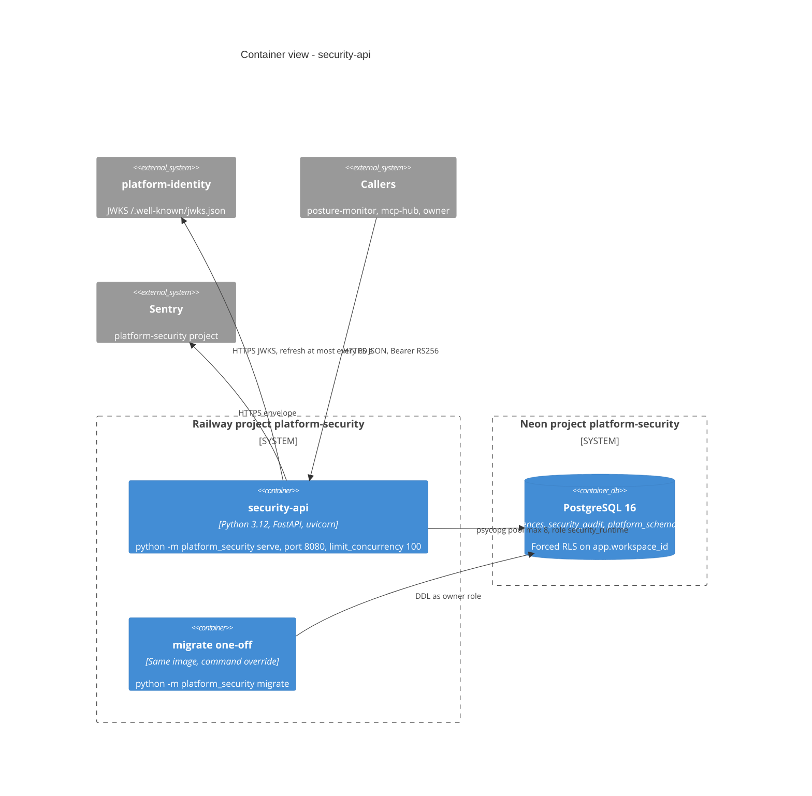

# 06 — C4 Container

Sources: `Dockerfile`, `railway.toml`, `src/platform_security/__main__.py`, `src/platform_security/migrations.py`, platform-backend-core@21d5f44 `db.py` (pool `max_size=8`), `auth.py` (`_JWKS` 60 s), `docs/runtime.md`, ops record: book-platforms-status (2026-11-03)

## Open questions

- `migrate` ถูกรันจากเครื่อง owner หรือเป็น Railway one-off (runtime.md บอกแค่ "ran once with the owner role")
