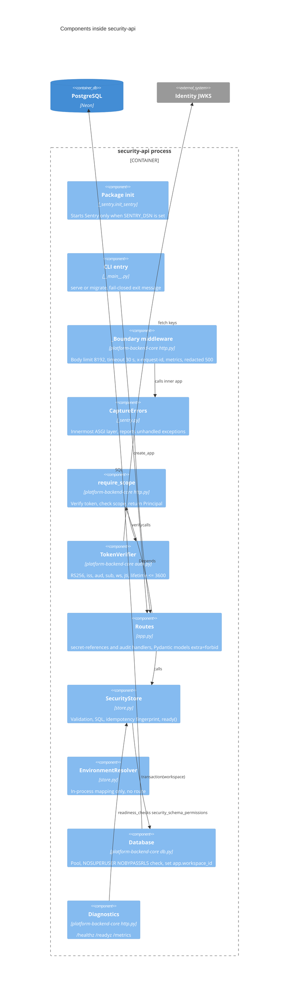

# 07 — C4 Component

Sources: `src/platform_security/__init__.py`, `src/platform_security/__main__.py`, `src/platform_security/app.py`, `src/platform_security/store.py`, `src/platform_security/_sentry.py`, platform-backend-core@21d5f44 `src/platform_backend_core/http.py`, `auth.py`, `db.py`

Note: `EnvironmentResolver` ไม่ถูกเรียกจาก `app.py` ใด ๆ (ใช้ใน test เท่านั้น)
