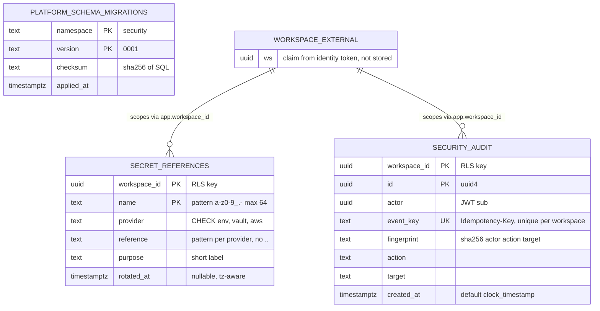

# 09 — ERD

Schema มาจาก migration เดียว `0001` (`src/platform_security/migrations.py`) กับตาราง `platform_schema_migrations` ที่ core `MigrationRunner` สร้าง ไม่มี foreign key; `workspace_id` และ `actor` เป็น UUID จาก JWT (`ws`, `sub`) ของ platform-identity ไม่มีตาราง workspace ใน DB นี้

`WORKSPACE_EXTERNAL` เป็น logical entity (ไม่มีตาราง) วาดเพื่อแสดง tenant key

Sources: `src/platform_security/migrations.py`, `src/platform_security/store.py`, platform-backend-core@21d5f44 `src/platform_backend_core/migrations.py`, `db.py`

## RLS และ runtime role

| ตาราง | RLS | Policy | Runtime grants (docs/runtime.md) | อื่น ๆ |
|---|---|---|---|---|
| `secret_references` | ENABLE + FORCE | `workspace` USING / WITH CHECK `workspace_id = nullif(current_setting('app.workspace_id',true),'')::uuid` | SELECT, INSERT, UPDATE | ไม่มี DELETE route / grant |
| `security_audit` | ENABLE + FORCE | เหมือนกัน | SELECT, INSERT; REVOKE UPDATE, DELETE, TRUNCATE | trigger `immutable_audit`; `REVOKE ALL FROM PUBLIC`; index `(workspace_id, created_at, id)` |
| `platform_schema_migrations` | ไม่มี | — | SELECT | เขียนโดย DDL role เท่านั้น |

- runtime role ใน production: `security_runtime` NOSUPERUSER NOBYPASSRLS (ops record: book-platforms-status (2026-11-03), `docs/runtime.md`)
- core ปฏิเสธ connection ถ้า role เป็น superuser หรือ bypassrls (`db.py` `_configure`)

## Contract entities ที่ยังไม่มีตาราง

`contracts/security/tenant.schema.json` (tenant + `status`), `audit-event.schema.json` (`outcome`, `privacy_class`, `prev_hash`, `metadata`), `privacy-class.schema.json` และ `permission.schema.json` เป็น JSON contract ที่ตรวจ offline เท่านั้น ไม่มี persisted data (gap G1)
