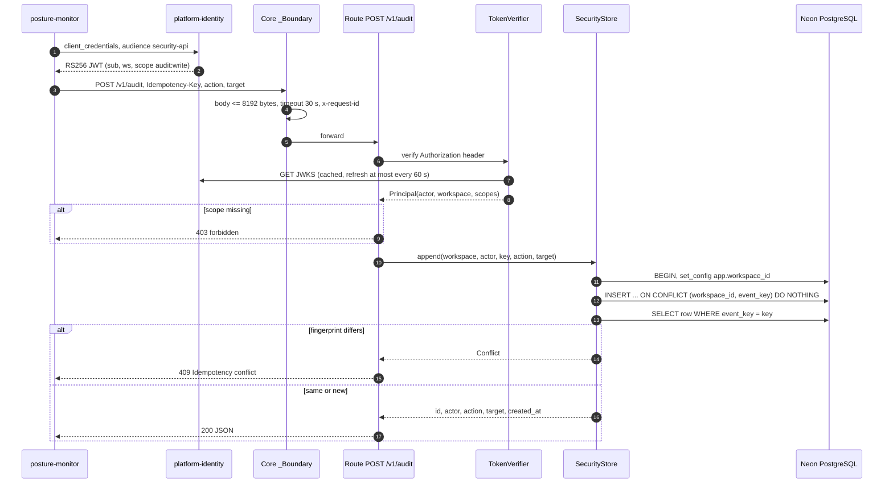
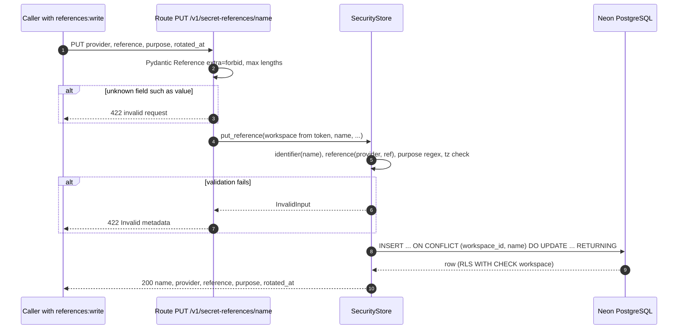
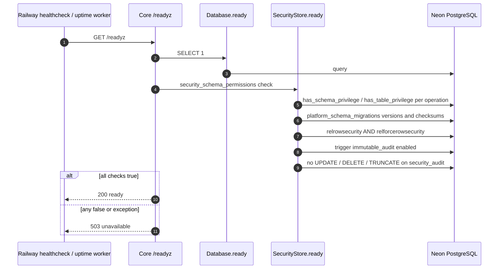
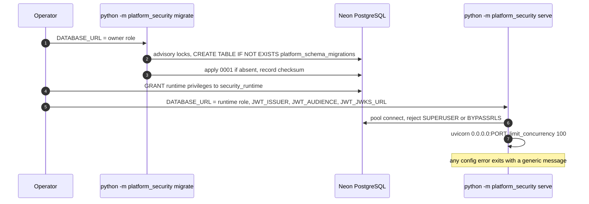

# 10 — Sequence diagrams

## S1 — Append audit event (posture-monitor → security-api)

## S2 — Upsert secret reference

## S3 — Readiness probe

## S4 — Release lifecycle (migrate then serve)

Sources: `src/platform_security/app.py`, `src/platform_security/store.py`, `src/platform_security/__main__.py`, `src/platform_security/migrations.py`, platform-backend-core@21d5f44 `http.py`, `auth.py`, `db.py`, `migrations.py`, `docs/runtime.md`, `.railway/railway.ts`, ops record: book-platforms-status (2026-11-03)
