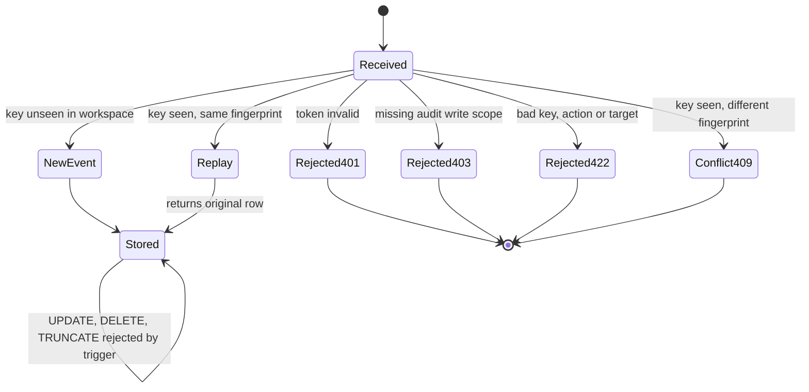
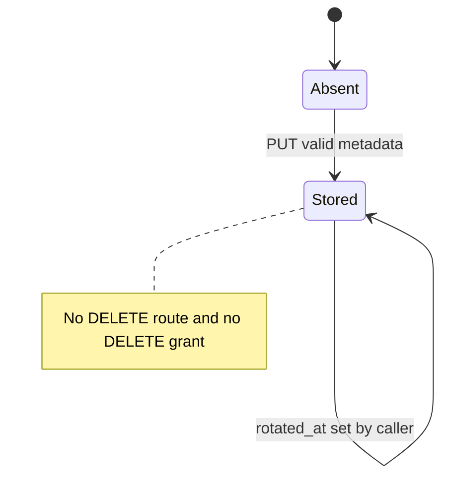
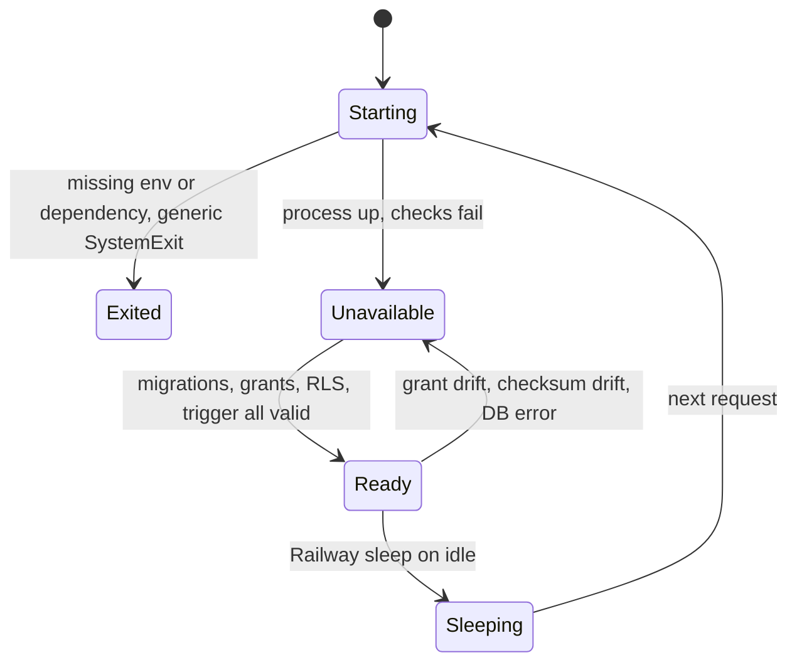
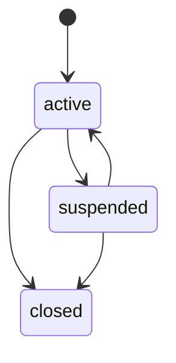

# 11 — State machines

ตารางใน DB ไม่มี status column lifecycle ที่มีจริงคือพฤติกรรมของ row/request ที่ code บังคับ ส่วน `tenant.status` อยู่ใน contract อย่างเดียว

## Audit append request (per Idempotency-Key)

## Secret reference row

## Service readiness

## Tenant status (contract only, not enforced)

contract นิยามแค่ enum `active | suspended | closed` และ action `tenant:manage` ("Suspend, close or rename a tenant") — ทิศทาง transition ข้างบนเป็น **interpretation** ของ enum ไม่ได้กำหนดใน schema

Sources: `src/platform_security/store.py`, `src/platform_security/app.py`, `src/platform_security/migrations.py`, `src/platform_security/__main__.py`, platform-backend-core@21d5f44 `http.py`, `docs/runtime.md` (grants), ops record: book-platforms-status (2026-11-03) (sleep on), `contracts/security/tenant.schema.json`, `contracts/security/permission-matrix.json`

## Open questions

- tenant transitions ที่อนุญาตจริง (เช่น `closed` → อื่นได้หรือไม่) ไม่มีใน contract
- Railway sleep → wake เป็นพฤติกรรม platform (ops record "sleep on") ไม่ได้อยู่ใน repo
