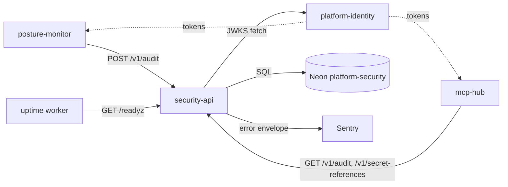

# 12 — API and integrations

สเปก API ฉบับเต็มอยู่ใน [`docs/runtime.md`](../runtime.md) ("Reference metadata and audit API") — ไฟล์นี้ **reuse** เนื้อหานั้นเป็นตาราง route จาก router code และเพิ่ม integration flow

## Routes (จาก `app.py` + core `create_app`)

| Method | Path | Scope | Request | Response | Idempotency |
|---|---|---|---|---|---|
| PUT | `/v1/secret-references/{name}` | `references:write` | JSON `provider` (≤8), `reference` (≤200), `purpose` (≤160), `rotated_at` (optional, tz-aware); `extra=forbid` | row `name, provider, reference, purpose, rotated_at` | Naturally idempotent: upsert on `(workspace_id, name)`, last write wins |
| GET | `/v1/secret-references` | `references:read` | `limit` 1..100 (default 100), `after` name (≤64) | list ordered by `name` | Safe read |
| POST | `/v1/audit` | `audit:write` | header `Idempotency-Key` (required, ≤128, `[A-Za-z0-9_.:-]`), JSON `action`, `target` (≤64, identifier pattern); `extra=forbid` | `id, actor, action, target, created_at` | Same key + same `actor/action/target` returns original event; changed → 409 |
| GET | `/v1/audit` | `audit:read` | `limit` 1..100, `after` UUID | list ordered by `id` (UUID, not time) | Safe read; pagination not a snapshot |
| GET | `/healthz` | none | — | `{"status":"ok"}` | — |
| GET | `/readyz` | none | — | 200 `ready` / 503 `unavailable` | — |
| GET | `/metrics` | none | — | Prometheus text: `platform_http_requests_total{route,status}`, duration sum | — |

Error mapping: 401 `unauthorized` (+ `WWW-Authenticate: Bearer`), 403 `forbidden`, 409 `Idempotency conflict`, 413 `request too large` (> 8192 bytes), 422 `invalid request` (schema) or `Invalid metadata` (domain `InvalidInput`), 500 `internal server error` (redacted), 504 `request timeout` (> 30 s). Every response carries `x-request-id`.

Sources: `src/platform_security/app.py`, `src/platform_security/store.py`, platform-backend-core@21d5f44 `src/platform_backend_core/http.py`, `docs/runtime.md`, `runtime_tests/test_error_mapping.py`

## External integrations

| Integration | Direction | How | Source |
|---|---|---|---|
| platform-identity JWKS | outbound HTTPS | `TokenVerifier(jwks_url=JWT_JWKS_URL)`, no redirects, ≤1 MiB, ≤64 keys, refresh ≤ every 60 s, timeout 5 s | `__main__.py`, core `auth.py` |
| Neon PostgreSQL | outbound TCP/TLS | `psycopg_pool`, `DATABASE_URL`, statement timeout 10 s | core `db.py` |
| Sentry | outbound HTTPS | `sentry_sdk.init` when `SENTRY_DSN` set; no trace propagation | `_sentry.py` |
| posture-monitor | inbound | service client → `POST /v1/audit` 200 | ops record |
| Remote MCP hub | inbound | cell `platform-security`, client `mcp-hub` | ops record |
| Uptime worker | inbound | `GET /readyz` hourly, in sleeping set | platform-uptime-worker `src/targets.ts` |

ไม่มี webhook, ไม่มี provider SDK (Vault / AWS / Infisical) — provider `vault`/`aws` เป็นแค่ label ของ reference; ไม่มี route ที่คืนค่า secret

Sources: เหมือนตารางด้านบน + ops record: book-platforms-status (2026-11-03)

## Open questions

- routes ที่ mcp-hub เรียกจริง (ops record ไม่ระบุ path)
- contract surface: ไม่มี `docs/CONTRACT-SURFACE.md` / OpenAPI snapshot ใน repo (FastAPI สร้าง `/openapi.json` และ `/docs` อัตโนมัติ เพราะ core ไม่ได้ปิด — ต้องยืนยันว่าต้องการเปิดใน production หรือไม่)
