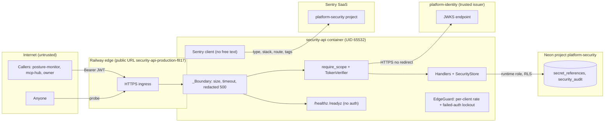

# 13 — Threat model (DFD + STRIDE)

central reference: [ATTACK-PATH-DIAGRAMS.md](https://github.com/bookchaowalit/architecture-docs/blob/main/docs/architecture/ATTACK-PATH-DIAGRAMS.md) (ยังไม่มี path ของ security-api)

## DFD with trust boundaries

## STRIDE per element

| Element | Threat | Existing mitigation (code) | Gap |
|---|---|---|---|
| Ingress / caller | **S**poofing with forged token | RS256 only, `iss`/`aud` strict, required claims, lifetime ≤ 3600 s, `alg` check, `crit` rejected (core `auth.py`) | no revocation / `jti` replay check; no gateway origin lock in this service |
| Ingress | **D**oS: large or slow requests | body ≤ 8192 (`app.py`), timeout 30 s, `limit_concurrency=100`, pool max 8 / max_waiting 64 + `EdgeGuard` (`_edge.py`): per-client 2 req/s burst 60, lockout after 10 × 401/403 (one forgiven per 30 s), 429 + `Retry-After`, client key = Railway `X-Real-IP`, table ≤ 4096 | no managed WAF (Cloudflare not in front of `*.up.railway.app`); single-replica in-memory state |
| Handlers | **T**ampering: cross-workspace write | workspace only from `ws`; forced RLS WITH CHECK; `extra=forbid` rejects `workspace`/`actor` fields | — |
| Handlers | **I**nformation disclosure: secret value stored | no `value` field, provider-specific patterns reject URLs / paths / `..` (`store.reference`); no resolve route | runtime has no `is_secret_like` heuristic (offline contract only); `purpose` free label |
| security_audit | **T**ampering / **R**epudiation | trigger `immutable_audit`, runtime role without UPDATE/DELETE/TRUNCATE, readiness enforces, actor from `sub`, idempotency fingerprint | owner/DDL role can still alter; no `prev_hash` chain (G1); no outcome field |
| DB connection | **E**levation via privileged role | core rejects SUPERUSER / BYPASSRLS role on connect; separate DDL role | — |
| JWKS fetch | **S**poofing via redirect / SSRF | HTTPS only, no userinfo, `_NoRedirect`, size cap, URL from env only | depends on identity key hygiene |
| Diagnostics | **I**nformation disclosure | `/openapi.json`, `/docs`, `/redoc`, `/metrics` removed from the app (404); schema lives in `contracts/`; generic 503 body | — |
| Errors / logs | **I**nformation disclosure | redacted 500; log line route/status/correlation id only; `access_log=False`; startup `SystemExit` hides config | — |
| Sentry egress | **I**nformation disclosure | no messages, breadcrumbs, locals, body, headers, user, trace propagation (`_sentry.py`) | ops record: no "active client + transport" guard in `CaptureErrors` (other 7 have it) |
| Supply chain | **T**ampering | core pinned by commit in `uv.lock`, actions SHA-pinned, uv image by digest; CI gitleaks / semgrep / osv-scanner / trivy-fs | — |

Sources: `src/platform_security/app.py`, `store.py`, `migrations.py`, `__main__.py`, `_sentry.py`, platform-backend-core@21d5f44 `auth.py`, `http.py`, `db.py`, `Dockerfile`, `.github/workflows/check.yml`, platform-ci-workflows@87dc5e1 `.github/workflows/security.yml`, `docs/runtime.md`, `docs/gates/BOO-163-security-policy-contracts.md`, ops record: book-platforms-status (2026-11-03)

## Open questions

- ควรเข้าผ่าน edge gateway เท่านั้นหรือไม่ (ถ้าใช่ service ยังไม่มี origin lock ตรวจ header)
- Railway / Neon network allowlist มีหรือไม่ (ไม่อยู่ใน repo)
