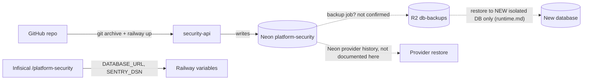

# 14 — Backup and disaster recovery

## Data inventory

| Data | Where | Criticality | Source |
|---|---|---|---|
| `secret_references` (metadata, no values) | Neon project `platform-security` (aws-ap-southeast-1, PG 16) | medium: pointers can be re-registered | `migrations.py`, `docs/runtime.md` |
| `security_audit` (append-only events) | same | high: audit history cannot be recreated | same |
| `platform_schema_migrations` | same | low: re-derivable from `MIGRATIONS` | core `migrations.py` |
| Connection strings, Sentry DSN | Infisical `/platform-security`, Railway variables | needed to restore service | ops record: book-platforms-status (2026-11-03) |
| Code + image recipe | GitHub `bookchaowalit-backend/platform-security` | rebuildable (`Dockerfile`, `uv.lock`) | repo |

เส้นประ = ไม่มีหลักฐานใน repo หรือ ops record ของ service นี้

Sources: `src/platform_security/migrations.py`, `docs/runtime.md` (Verification and release gate; Sentry and first deployment), ops record: book-platforms-status (2026-11-03), [ADR-0002 production baseline](https://github.com/bookchaowalit/architecture-docs/blob/main/docs/architecture/decisions/ADR-0002-production-baseline-monitoring-backups.md)

## Backup / restore reality

- repo นี้ **ไม่มี** backup workflow หรือ script
- `docs/runtime.md`: "Runtime role and backup/restore provisioning remain operator release work"; "no scheduled deletion or backup credential access is implemented here"
- Rollback rule (`docs/runtime.md`): หยุด runtime แล้วคืน consumer ไป adapter เดิม; **ห้าม** downgrade SQL หรือเขียนทับ live DB; restore ไป DB ใหม่ที่แยก แล้ว verify synthetic workspace reads ก่อน cutover
- Central baseline ADR-0002 กำหนด nightly `pg_dump` → age → R2 `db-backups` ด้วย role `db_backup` ต่อ Neon project — แต่ไม่มีหลักฐานว่า Neon `platform-security` (สร้าง 2026-11-02) ถูกเพิ่มเป็น target แล้ว
- trigger `immutable_audit` กัน TRUNCATE/DELETE จาก runtime role แต่ไม่กัน DDL role / การลบ Neon project

## RTO / RPO

- RTO: **not defined**
- RPO: **not defined**

## Open questions

- Neon `platform-security` อยู่ใน `ops-backups/db-backup` targets แล้วหรือยัง (และมี role `db_backup` หรือไม่)
- Neon history retention / PITR window ของ project นี้เท่าไร
- RTO / RPO ที่ owner ต้องการสำหรับ audit log
- restore drill รายเดือนรวม service นี้หรือยัง
