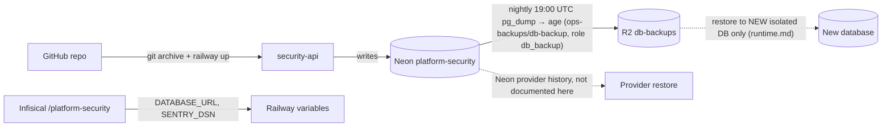

# 14 — Backup and disaster recovery

## Data inventory

| Data | Where | Criticality | Source |
|---|---|---|---|
| `secret_references` (metadata, no values) | Neon project `platform-security` (aws-ap-southeast-1, PG 16) | medium: pointers can be re-registered | `migrations.py`, `docs/runtime.md` |
| `security_audit` (append-only events) | same | high: audit history cannot be recreated | same |
| `platform_schema_migrations` | same | low: re-derivable from `MIGRATIONS` | core `migrations.py` |
| Connection strings, Sentry DSN | Infisical `/platform-security`, Railway variables | needed to restore service | ops record: book-platforms-status (2026-11-03) |
| Code + image recipe | GitHub `bookchaowalit-backend/platform-security` | rebuildable (`Dockerfile`, `uv.lock`) | repo |

เส้นประ = ไม่มีหลักฐานใน repo หรือ ops record ของ service นี้

Sources: `src/platform_security/migrations.py`, `docs/runtime.md` (Verification and release gate; Sentry and first deployment), ops record: book-platforms-status (2026-11-03), [ADR-0002 production baseline](https://github.com/bookchaowalit/architecture-docs/blob/main/docs/architecture/decisions/ADR-0002-production-baseline-monitoring-backups.md)

## Backup / restore reality

- repo นี้ **ไม่มี** backup workflow หรือ script
- `docs/runtime.md`: "Runtime role and backup/restore provisioning remain operator release work"; "no scheduled deletion or backup credential access is implemented here"
- Rollback rule (`docs/runtime.md`): หยุด runtime แล้วคืน consumer ไป adapter เดิม; **ห้าม** downgrade SQL หรือเขียนทับ live DB; restore ไป DB ใหม่ที่แยก แล้ว verify synthetic workspace reads ก่อน cutover
- Nightly backup (ADR-0002) รวม service นี้แล้วตั้งแต่ 2026-11-04: Neon role `db_backup` (สมาชิก `neon_superuser`, BYPASSRLS — จำเป็นเพราะ forced RLS), target `platform-security` ใน `BACKUP_TARGETS` และ `BACKUP_URL_PLATFORM_SECURITY` ของ Railway `ops-backups/db-backup` (cron 19:00 UTC) → age → R2 `db-backups` (14 / 56 / 365 วัน)
- Restore test 2026-11-04: `pg_dump -Fc` ด้วย role `db_backup` → `pg_restore --no-owner --no-privileges` ลง scratch PG 16 → row count ตรงกันทุกตาราง (`security_audit` 22, `secret_references` 0, `platform_schema_migrations` 1) แล้วลบ scratch DB
- trigger `immutable_audit` กัน TRUNCATE/DELETE จาก runtime role แต่ไม่กัน DDL role / การลบ Neon project

## RTO / RPO

| Scenario | RPO | RTO | How |
|---|---|---|---|
| Bad write / accidental change (Neon project still there) | ≤ Neon history window (PITR) | 1 h | Neon branch at a timestamp → verify → point a NEW runtime at it |
| Neon project or account lost | 24 h (nightly dump) | 4 h | newest R2 dump → age decrypt → new Neon project → `migrate` check → readiness 200 → switch `DATABASE_URL` |
| Service / image lost | 0 (data untouched) | 30 min | `git archive main` + `railway up --ci` |

Audit is append-only and cannot be recreated, so the 24 h RPO is the accepted worst case on the free plan. Callers retry `POST /v1/audit` with the same `Idempotency-Key`, so events sent during an outage are not lost if the caller keeps them.

Restore drill: the monthly drill (`platform-db-backup/docs/runbook.md`) lists `platform-security` in `DRILL_TARGETS` from 2026-11; the drill creates the role its RLS policies name (`security_runtime`) as NOLOGIN before restoring, and compares row counts with the backup manifest.

## Open questions

- Neon history retention / PITR window ของ project นี้เท่าไร
- owner ยืนยันค่า RTO / RPO ข้างบน (ตั้งจากสิ่งที่ free plan ทำได้จริง)
