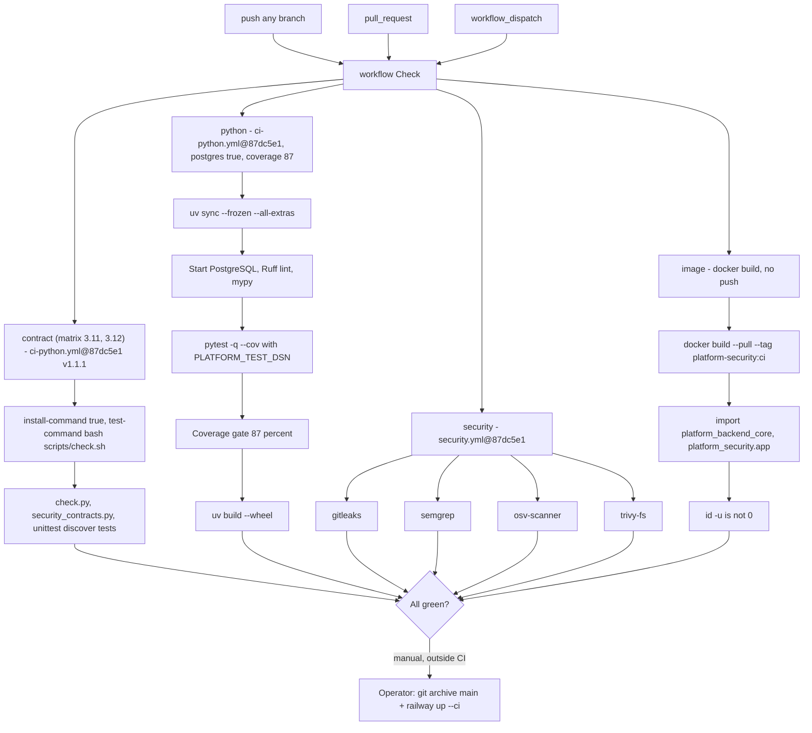

# 15 — CI/CD pipeline

workflow เดียว: `.github/workflows/check.yml` (`name: Check`) trigger `push` (ทุก branch), `pull_request`, `workflow_dispatch`; `permissions: contents: read`; `concurrency: check-${{ github.ref }}` cancel-in-progress สี่ job ไม่มี `needs` ระหว่างกัน (รันขนาน) และ **ไม่มี deploy job**

`format-check: false` ใน ทั้ง `contract` และ `python` (follow-up: ruff format); `typecheck-command: ""` ใน `contract`

Sources: `.github/workflows/check.yml`, platform-ci-workflows@87dc5e1 `.github/workflows/ci-python.yml` (steps Checkout, Set up uv and Python, Install dependencies, Start PostgreSQL, Lint (Ruff), Typecheck, Test, Coverage gate, Drop CI database), platform-ci-workflows@87dc5e1 `.github/workflows/security.yml` (jobs gitleaks, semgrep, osv-scanner, trivy-fs), `scripts/check.sh`, `docs/runtime.md`, ops record: book-platforms-status (2026-11-03) (deploy recipe)

หมายเหตุ: workflow `Shared runtime` (`shared-runtime.yml`, เห็นใน `gh run list` ถึง 2026-10-23) ถูกลบใน commit `52c1cae` และย้าย PostgreSQL tests เข้า job `python` (comment ใน `check.yml`)

## Open questions

- Railway service ต่อ GitHub (auto deploy on push) หรือ CLI อย่างเดียว
