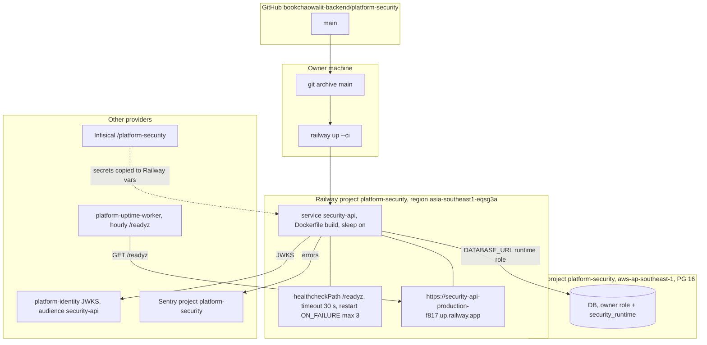

# 16 — Deployment

## Runtime config (env names from code)

| Variable | Use | Source |
|---|---|---|
| `DATABASE_URL` | runtime role for `serve`, DDL role for `migrate` | `__main__.py`, `docs/runtime.md` |
| `JWT_ISSUER`, `JWT_AUDIENCE` | identity issuer, `security-api` | `__main__.py`, `docs/runtime.md` |
| `JWT_JWKS_URL` or `JWT_PUBLIC_KEY` | exactly one | `__main__.py`, core `auth.py` |
| `PORT` | default 8080 | `__main__.py`, `Dockerfile` |
| `SENTRY_DSN`, `SENTRY_ENVIRONMENT`, `SENTRY_RELEASE` | Sentry init | `_sentry.py` |
| `RAILWAY_GIT_COMMIT_SHA`, `RAILWAY_SERVICE_NAME` | release + `service` tag | `_sentry.py` |

Health: `/healthz` = process alive (no DB); `/readyz` = DB + schema/grant/RLS/trigger checks (Railway healthcheck ใช้ตัวนี้) Serverless sleep หมายถึง request แรกหลัง idle ต้องรอ container start + Neon resume (core pool timeout 20 s, connect timeout 15 s)

Sources: `railway.toml`, `Dockerfile`, `src/platform_security/__main__.py`, `src/platform_security/_sentry.py`, platform-backend-core@21d5f44 `db.py`, `http.py`, `docs/runtime.md`, ops record: book-platforms-status (2026-11-03), platform-uptime-worker `src/targets.ts`

## Open questions

- deployed commit ปัจจุบันคืออะไร (first deploy 2026-11-02; 0187719 ไม่มีบันทึก deploy)
- custom domain หรือ gateway route สำหรับ service นี้
- staging environment: ไม่มี (มีแค่ production ใน docs)
