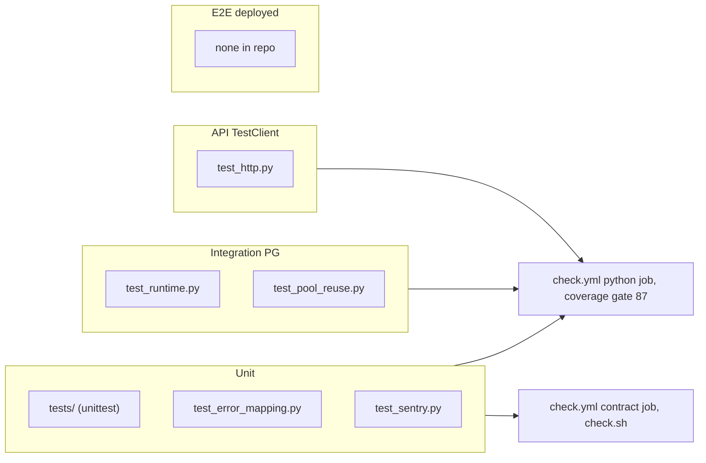

# 17 — Test coverage matrix

ระดับ test ที่มีจริง:
- **Unit (offline)** = `tests/` (stdlib `unittest`, รันใน `scripts/check.sh` และ pytest) + `runtime_tests/test_error_mapping.py`, `test_sentry.py` (ไม่ต้องใช้ DB)
- **Integration (PostgreSQL)** = `runtime_tests/test_runtime.py`, `test_pool_reuse.py` (ต้องมี `PLATFORM_TEST_DSN`, ไม่งั้น skip)
- **API (in-process HTTP)** = `runtime_tests/test_http.py`, `test_error_mapping.py`, `test_pool_reuse.py::test_http_pool_reuse_after_success_and_conflict` ผ่าน FastAPI `TestClient` + JWT จริง
- **E2E (deployed)** = ไม่มี test file; มีแค่ smoke ที่บันทึกใน `docs/runtime.md` / ops record (`/readyz` 200, unauthenticated 401, posture-monitor 200)

| Feature | Unit | Integration (PG) | API (TestClient) | E2E | Gap |
|---|---|---|---|---|---|
| Secret reference validation (provider, pattern, `..`, purpose, tz) | `test_error_mapping.py::test_store_validation_raises_invalid_input` | `test_runtime.py::test_reference_only_and_unknown_resolution` | `test_http.py::test_secret_value_rejected_audit_identity_bound_and_permissions` | — | no test for `rotated_at` naive datetime via HTTP |
| Secret reference list + pagination (`after`) | — | partial (`test_runtime` lists other workspace) | partial (`test_http` empty foreign list) | — | `after` cursor and `limit` bounds untested over HTTP |
| Audit append idempotency / 409 | `tests/test_security_contracts.py::AuditTests` (offline `AuditLog`) | `test_runtime.py::test_audit_append_idempotent_and_immutable`, `::test_audit_concurrent_dedupe_is_atomic` | `test_http.py` (409), `test_pool_reuse.py` | posture-monitor 200 (ops record) | — |
| Audit immutability (trigger) | — | `test_runtime.py::test_audit_append_idempotent_and_immutable` | — | — | TRUNCATE not exercised directly |
| Workspace isolation (RLS) | `AuditTests::test_tenant_isolation` (offline) | `test_runtime.py::test_reference_and_audit_force_rls_reject_foreign_inserts`, `test_pool_reuse.py::test_store_pool_reuse_after_audit_conflict_and_isolation` | `test_http.py` foreign workspace list `[]` | — | — |
| Scope enforcement 401 / 403 | — | — | `test_http.py` (403 with empty scope) | unauthenticated 401 (runtime.md) | 401 path not asserted in repo tests |
| Readiness checks | — | — | `test_http.py` 4 tests (missing schema, checksum, each privilege, forbidden audit privilege) | `/readyz` 200 (runtime.md) | — |
| Error mapping 422 vs 500 | `test_error_mapping.py::test_invalid_input_is_a_value_error`, `::test_non_uuid_actor_is_a_server_bug_not_invalid_input` | — | `test_error_mapping.py::test_domain_validation_returns_422`, `::test_unexpected_value_error_is_redacted_500` | — | — |
| Sentry scrub / no free text | `test_sentry.py` (10 test functions incl. real-client `test_no_exception_text_leaves_the_process`) | — | `test_sentry.py::test_a_server_500_reaches_sentry_scrubbed` | `sentry: enabled` (ops record) | — |
| EnvironmentResolver | — | `test_runtime.py::test_reference_only_and_unknown_resolution` | — (no route) | — | — |
| BOO-163 contracts (tenant, permission, secret ref, audit, privacy) | `tests/test_security_contracts.py` (32), `tests/test_contract_files.py` | — | — | — | runtime conformance not tested (G1) |
| Repo contract / scaffold | `tests/test_check.py` | — | — | — | — |
| Build hygiene (Dockerfile, pins) | `tests/test_build_hygiene.py` | — | — | CI `image` job | — |
| Migrations runner (drift) | — | indirectly via fixtures | `test_http.py::test_applied_migration_checksum_required` | — | core runner tests live in core repo |

Coverage: gate 87 % (`check.yml`), measured 87.06 % on 2026-10-24 (comment), 88 % on 2026-11-02 (`docs/runtime.md`)

Sources: `tests/*.py`, `runtime_tests/*.py`, `scripts/check.sh`, `pyproject.toml` (`testpaths`), `.github/workflows/check.yml`, `docs/runtime.md`, ops record: book-platforms-status (2026-11-03)
