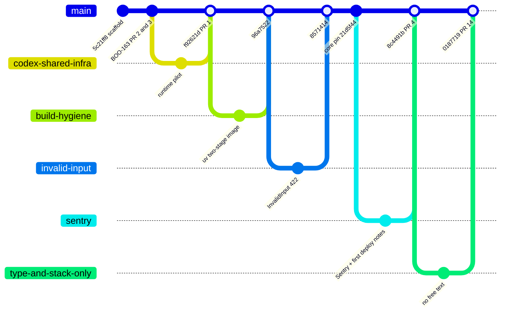
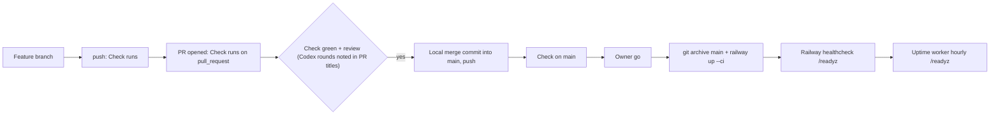

# 18 — Git and release workflow

จาก `git log origin/main`: งานทำบน feature branch (เช่น `sentry`, `jwt-tail`, `build-hygiene`, `invalid-input`) → push (CI `Check` รันบน push และ pull_request) → merge เข้า `main` เป็น merge commit `Merge PR #N: …` หรือ `Merge <topic>` (merge ใน local clone แล้ว push) → `Check` รันบน `main` → deploy เป็นขั้นแยกด้วย Railway CLI ไม่มี tag / GitHub release

(PR #5–#13 ถูก merge ระหว่าง 8c4491b และ 0187719 ในรูปแบบเดียวกัน ย่อไว้)

Sources: `git log --merges origin/main`, `gh pr list --state merged`, `gh run list` (branches `sentry`, `jwt-tail`, …), `.github/workflows/check.yml`, `docs/runtime.md` ("Deployed (owner go 2026-11-02)"), `railway.toml`, ops record: book-platforms-status (2026-11-03) (deploy recipe)

## Open questions

- branch protection / required checks บน `main` (ไม่อยู่ใน repo)
- PR #1 ไม่ปรากฏใน `gh pr list --state merged` (merge commit `f92621d` บอก "Merge PR #1") — น่าจะ merge local แล้วปิด PR
