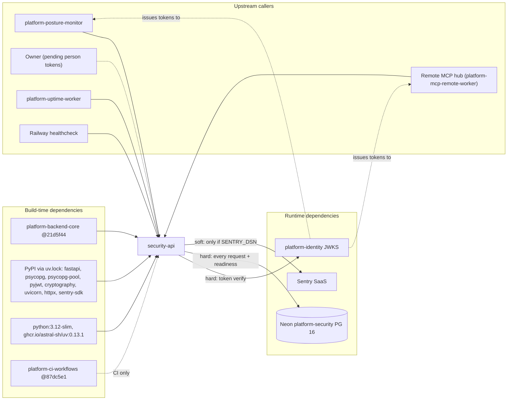

# 19 — Service dependency map

`contract.json` ประกาศ `depends_on: ["observability"]` แต่ runtime ไม่ได้ import หรือเรียก platform-observability (ops record: observability เป็น library ไม่ใช่ service) runtime dependencies จริง:

Failure impact: identity JWKS down → token verify fails → 401 ทุก API call (JWKS cache ล้างเมื่อ refresh ล้มเหลว); Neon down → `/readyz` 503 และ API 500 / 504; Sentry down → ไม่กระทบ request

Sources: `contract.json`, `pyproject.toml`, `uv.lock`, `Dockerfile`, `.github/workflows/check.yml`, `src/platform_security/__main__.py`, `_sentry.py`, platform-backend-core@21d5f44 `auth.py` (`_JWKS` "Old keys are not trusted indefinitely after a failed refresh"), `db.py`, ops record: book-platforms-status (2026-11-03), platform-uptime-worker `src/targets.ts`

## Open questions

- `depends_on: observability` ควรคงไว้หรือแก้ (runtime ไม่มี dependency นี้)
- ใครเป็น consumer ของ `secret_references` ในอนาคต (contract.json บอก platform อื่น เช่น ai/payment เป็นสมมติฐานใน DOCPACK)
