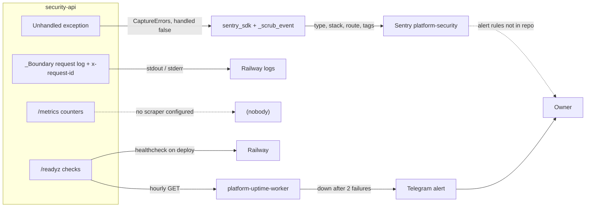

# 20 — Observability

สัญญาณที่มีจริงใน code และ ops record:

| Signal | Producer | Content | Consumer / watched? | Source |
|---|---|---|---|---|
| Sentry error events | `_sentry.init_sentry` + `CaptureErrors` + FastAPI integration | exception type, stack (file, function, line), route template, tags (`service`), release, environment; **no** messages / breadcrumbs / locals / request data | Sentry project `platform-security` (org personal-yu0) | `_sentry.py`, ops record |
| Startup line | `print("sentry: enabled for …")` to stderr | service name | Railway logs | `_sentry.py` |
| Request log | core `_Boundary` `_LOG.info` | `route=<template> status=<code> correlation_id=<uuid>` | Railway logs (only if INFO logging is configured) | core `http.py` |
| `x-request-id` header | core `_Boundary` | per-request UUID (same as correlation_id) | caller | core `http.py` |
| `/metrics` | core | `platform_http_requests_total{route,status}`, `platform_http_request_duration_seconds_sum` (in-memory, resets on restart/sleep) | **no scraper** (ops record: observability is a library, decision pending) | core `http.py` |
| `/readyz` | core + `SecurityStore.ready` | ready / unavailable | Railway healthcheck; platform-uptime-worker hourly, sleeping set → Telegram | `railway.toml`, `src/targets.ts` |
| `/healthz` | core | ok | not used by monitors | core `http.py` |
| uvicorn access log | disabled (`access_log=False`) | — | — | `__main__.py` |

Sources: `src/platform_security/_sentry.py`, `src/platform_security/app.py`, `src/platform_security/__main__.py`, platform-backend-core@21d5f44 `http.py`, `railway.toml`, platform-uptime-worker `src/targets.ts` (target `security-api` + sleeping set), [ADR-0002](https://github.com/bookchaowalit/architecture-docs/blob/main/docs/architecture/decisions/ADR-0002-production-baseline-monitoring-backups.md) (2 consecutive failures, Telegram), ops record: book-platforms-status (2026-11-03)

## Open questions

- Sentry alert rules / notification channel สำหรับ project `platform-security`
- Sentry `release`: ใช้ `RAILWAY_GIT_COMMIT_SHA` — deploy แบบ `railway up` จาก `git archive` ตั้งค่านี้หรือไม่ (ถ้าไม่ release = None, `test_release_is_unset_without_a_git_sha`)
- Python logging level ของ process (core logger INFO จะออกหรือไม่ขึ้นกับ uvicorn default)
- ไม่มี audit-volume / business metric (เช่นจำนวน audit ต่อวัน) และไม่มี heartbeat
