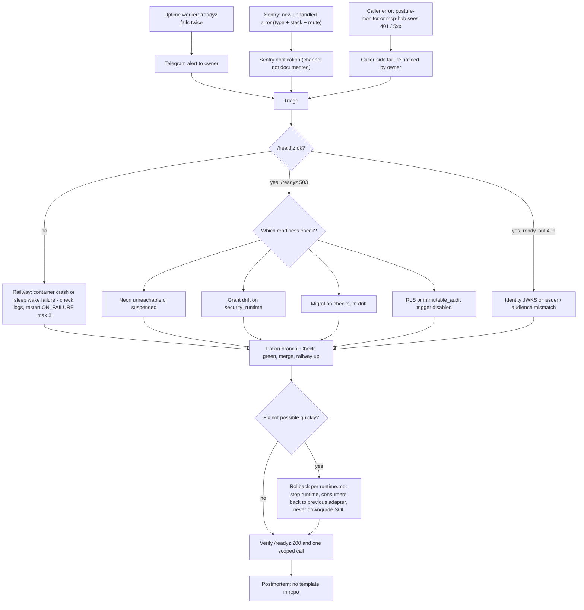

# 21 — Incident response

repo นี้ **ไม่มี** `RUNBOOK.md` หรือ postmortem template flow ด้านล่างประกอบจาก alert channel และ rollback rule ที่มีจริง

ตัวอย่างจริงของ "fix-forward" อยู่ใน `docs/runtime.md` (เช่น review rounds PR #4–#14 Sentry, readiness regression 2026-10-15) แต่ไม่ใช่ production incident

Sources: platform-uptime-worker `src/targets.ts`, [ADR-0002](https://github.com/bookchaowalit/architecture-docs/blob/main/docs/architecture/decisions/ADR-0002-production-baseline-monitoring-backups.md), `src/platform_security/_sentry.py`, `src/platform_security/store.py` (`ready`), platform-backend-core@21d5f44 `http.py`, `auth.py`, `railway.toml`, `docs/runtime.md` (rollback paragraph), ops record: book-platforms-status (2026-11-03)

## Open questions

- Sentry notification channel และ severity rules
- on-call / response target (solo owner) และ postmortem location
- runbook สำหรับ rotate `security_runtime` password / Sentry DSN (runtime.md: credential rotation belongs to release gates)
- posture-monitor แจ้งเตือนเมื่อ security-api ตอบผิดพลาดหรือไม่ (ไม่อยู่ใน ops record ของ service นี้)
