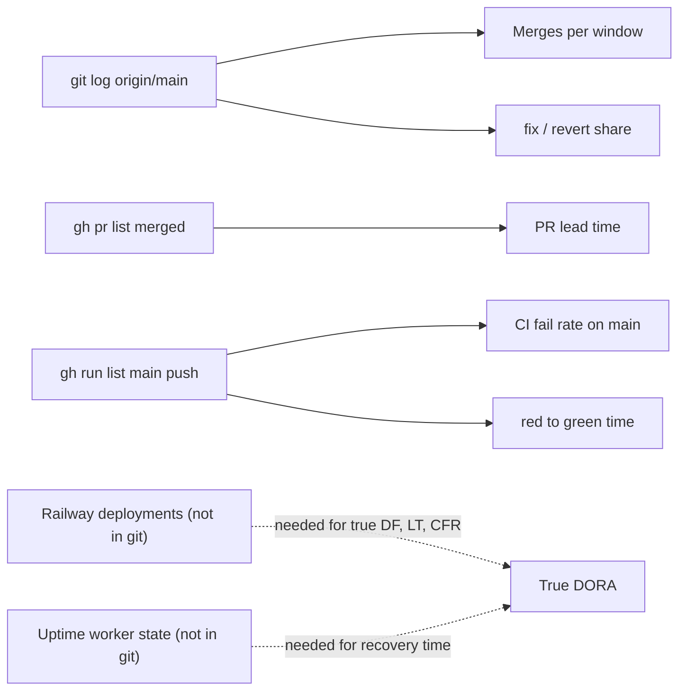

# 22 — DORA metrics

หน้าต่าง: 90 วันถึง 2026-11-03 (`--since=90.days`; repo เริ่ม 2026-09-17) Deploy ของ service นี้เป็น **CLI** (`railway up --ci` จาก `git archive main`, ops record) ไม่มี deploy job ใน GitHub Actions ดังนั้น git/gh **ไม่เห็น deploy** เห็นได้แค่ merge เข้า `main` และ CI บน `main`

| Metric | How to measure for this repo | Current value (90 d) | Command | Confidence |
|---|---|---|---|---|
| Deployment frequency | ควรนับจาก Railway deployment list; git/gh ไม่มีข้อมูล deploy | **1 recorded deploy** (2026-11-02, `docs/runtime.md`). Proxy: 16 merges to `main` | `git log --since=90.days --merges --oneline origin/main \| wc -l` | low: deploys after PR #4 not recorded |
| Lead time for changes | PR open → merge (proxy); commit → deploy ไม่ได้ | median **2.1 min**, min 0.95, max 10.9 (13 PRs via GitHub) | `gh pr list -R bookchaowalit-backend/platform-security --state merged -L 50 --json createdAt,mergedAt --jq '[.[]\|((.mergedAt\|fromdate)-(.createdAt\|fromdate))/60]\|sort'` | low: PR opened after work done on branch; deploy step missing |
| Change fail rate | ควรเป็น deploys ที่ทำให้ prod เสีย; proxy = `Check` failures บน push to `main` | **1 / 22 = 4.5 %** (581f38c, 2026-10-22, Ruff EXE001) | `gh run list -R bookchaowalit-backend/platform-security --branch main --event push -L 200 --json conclusion --jq 'group_by(.conclusion)\|map({c:.[0].conclusion,n:length})'` | medium for CI, unknown for prod |
| Failed deployment recovery time | ควรวัดจาก uptime worker down → recovery; proxy = red main → next green main | **3 min 7 s** (09:41:36Z → 09:44:43Z, fix fb61d9e) | `gh run list -R bookchaowalit-backend/platform-security --branch main --event push -L 30 --json createdAt,conclusion,headSha` | CI proxy only; no prod incident data |
| Deployment rework rate | ควรเป็น unplanned deploys เพื่อแก้ prod; proxy = share of non-merge commits on `main` whose subject starts `fix` / `revert` | **19 / 43 non-merge commits = 44 %** (mostly Sentry scrubber rounds PR #5–#13, not prod incidents) | `git log --since=90.days --no-merges --format=%s origin/main \| grep -ciE '^(fix\|revert)'` และ `git log --since=90.days --no-merges --oneline origin/main \| wc -l` | low: review-driven rework, not deploy rework |

หมายเหตุการนับ: `git log --since=90.days --oneline origin/main` = 59 commits (16 merges + 43 non-merge)

Sources: `git log origin/main` (at 0187719), `gh pr list`, `gh run list` (run 2026-10-22 failed jobs "Contract and tests (Python 3.11/3.12) / python"), `docs/runtime.md`, ops record: book-platforms-status (2026-11-03) (deploy recipe)

## Open questions

- Railway deployment history ของ `security-api` (ใช้ `railway deployments` หรือ GraphQL) เพื่อคำนวณ DF / LT / CFR จริง
- จะบันทึก deploy SHA ที่ไหน (เช่น ตั้ง `SENTRY_RELEASE` หรือ log ใน runtime.md ทุกครั้ง)
